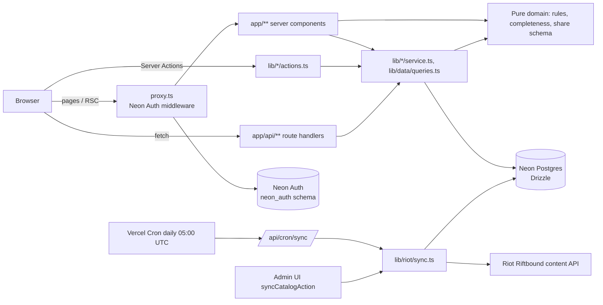
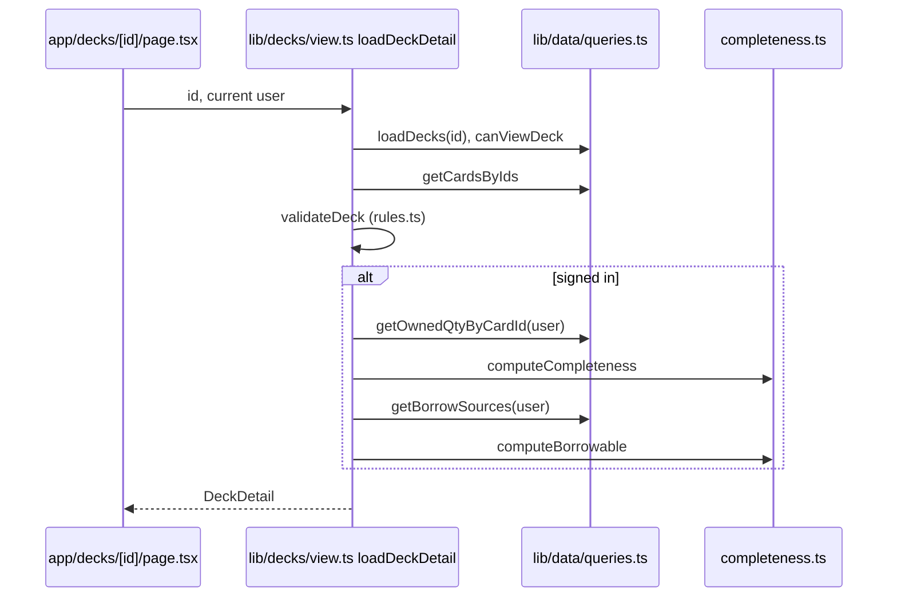
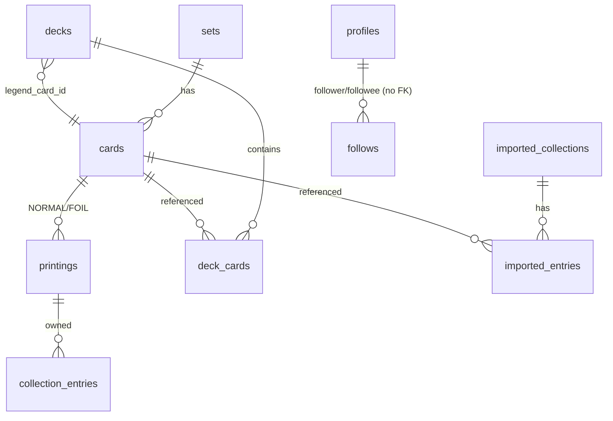

# REPO_GUIDE.md — Riftbound Deckbuilder

Primary reference for developers and AI coding agents. **Verify against source before relying on any claim**; update this file in the same change as any code change that affects it (see [§P](#p-documentation-metadata) and [§O](#o-navigation-guide-for-ai-agents)).

---

## A. Project Overview

**What it is.** A web app for the *Riftbound* trading card game (Riot Games): track which cards you own, build/validate decks, and see how *complete* each deck is against your collection, including which missing cards friends could lend you.

**Problem solved.** Players want to know "how close am I to building this tournament list?" and "who can lend me the rest?"

**Audience.** Riftbound players; admins (allow-listed by email) curate featured "META" decks and trigger catalog syncs.

**Core capabilities (confirmed in code)**
- Browse/search the card catalog (`/cards`, `/cards/[code]`).
- Maintain a per-printing collection (NORMAL / FOIL / ALT_ART): single add, bulk text add, JSON import/export.
- Build, edit, import/export decks across six zones; live rules validation (advisory).
- Deck completeness % vs. your collection; "with friends" % using borrowable copies.
- Social: collection visibility (PRIVATE/LINK/PUBLIC), share-token links, follow by link, imported JSON "snapshots" as borrow sources.
- Admin: feature/flag decks, import META decks from JSON, trigger Riot catalog sync.
- Daily Vercel cron syncs the card catalog from Riot's API.

**Out of scope / not implemented**
- Riot Sign-On (RSO): only a disabled "Sign in with Riot (coming soon)" button exists behind `RSO_ENABLED` ([app/auth/[path]/page.tsx](app/auth/[path]/page.tsx)).
- No real lending/trade workflow — "borrow" is read-only computation.
- No win-rate/metagame stats (explicitly avoided; see [data/meta-decks/README.md](data/meta-decks/README.md)).
- No end-to-end/UI tests, no CI pipeline in repo.

**High-level flow.** Next.js App Router pages (server components) call plain TypeScript service modules in `lib/**` that use Drizzle against Neon Postgres. Mutations are Server Actions that derive the user from the Neon Auth session and delegate to services. Pure domain logic (deck rules, completeness) is DB-free and shared between server and client.

> **Data status (from project memory, not verifiable from code):** Riot's Riftbound content endpoint returns 403 until Riot approves the API key; the app can run on DEV placeholder cards (`npm run riot:sync -- --placeholder`). Cards then carry `isPlaceholder = true` and show a badge.

---

## B. Goals and Use Cases

| # | Use case | Entry points | Key rules |
|---|---|---|---|
| 1 | Sign up / sign in (email+password, Google, optional GitHub) | [app/auth/[path]/page.tsx](app/auth/[path]/page.tsx), [app/providers.tsx](app/providers.tsx), [app/api/auth/[...path]/route.ts](app/api/auth/[...path]/route.ts) | Neon Auth (managed Better Auth). `requireEmailVerification: false`. Post-login redirect `/collection`. |
| 2 | Browse cards | [app/cards/page.tsx](app/cards/page.tsx), [app/cards/[code]/page.tsx](app/cards/[code]/page.tsx), `lib/collection/library.ts` (`listCards`, `getCardDetail`) | Public route. Filters: q/type/faction/rarity/set; page size 24. |
| 3 | Manage collection | [app/collection/page.tsx](app/collection/page.tsx), [app/collection/add/page.tsx](app/collection/add/page.tsx), `components/collection/*`, `lib/collection/actions.ts` → `service.ts` | Qty clamped 0–9999; bulk ≤500 lines; ownership is per *card* regardless of variant when computing completeness. |
| 4 | Build/edit a deck | [app/decks/new](app/decks/new/page.tsx), [app/decks/[id]/edit](app/decks/[id]/edit/page.tsx), `components/decks/deck-editor.tsx`, `lib/decks/actions.ts` → `service.saveUserDeck` | Save does **not** enforce rule validity (only schema + cards exist). Rules shown as advisory badges. |
| 5 | View deck + completeness | [app/decks/[id]/page.tsx](app/decks/[id]/page.tsx), `lib/decks/view.ts` (`loadDeckDetail`) | Private decks visible only to owner (`canViewDeck`). Completeness only when signed in. |
| 6 | Import/export decks | `components/decks/import-deck-form.tsx`, [app/api/decks/[id]/export/route.ts](app/api/decks/[id]/export/route.ts), `lib/share/schema.ts` | Formats contain only public codes + counts (`riftbound-deck` v1). Imported decks are private. |
| 7 | Share collection & follow friends | [app/settings/sharing](app/settings/sharing/page.tsx), [app/share/[token]](app/share/[token]/page.tsx), [app/friends](app/friends/page.tsx), `lib/social/*` | Unknown token and PRIVATE are indistinguishable (404). Share token rotatable. |
| 8 | Borrow analysis | [app/borrow/page.tsx](app/borrow/page.tsx), `computeBorrowable` | Sources = followed users with non-PRIVATE collections + own imported snapshots. |
| 9 | Admin | [app/admin/page.tsx](app/admin/page.tsx), `components/decks/admin-*.tsx` | `ADMIN_EMAILS` allow-list; non-admins get 404. |
| 10 | Catalog sync | [app/api/cron/sync/route.ts](app/api/cron/sync/route.ts), `lib/riot/sync.ts`, `scripts/sync.ts` | Cron needs `Authorization: Bearer $CRON_SECRET`. Upsert-only; never deletes. |

---

## C. Technology Stack

| Area | Tech (version from [package.json](package.json)) | Notes |
|---|---|---|
| Language | TypeScript 5 (strict via [tsconfig.json](tsconfig.json)) | Path alias `@/*` |
| Framework | **Next.js 16.4.3**, React 19.3 (App Router) | `cacheComponents: true`, `partialPrefetching: true` in [next.config.ts](next.config.ts). **Not the Next.js in most training data** — read `node_modules/next/dist/docs/` first ([AGENTS.md](AGENTS.md)). Auth gate is `proxy.ts` (not `middleware.ts`). |
| DB | Neon Postgres via `pg` Pool + **Drizzle ORM 0.45**, drizzle-kit 0.31 | `pg_trgm` extension for fuzzy name search |
| Auth | **Neon Auth** (`@neon/auth`, managed Better Auth ~1.7) + `@better-auth-ui/*` | UI vendored under `components/auth/` |
| UI | Tailwind CSS 4 (`@tailwindcss/turbopack`), shadcn-style components in `components/ui`, `radix-ui`, `@base-ui/react`, lucide-react, sonner, next-themes | [components.json](components.json) |
| Data/forms | zod 4 (validation), TanStack Query (provider only, in `app/providers.tsx`), TanStack Form (auth UI) | |
| Testing | Vitest 5 (node env) | |
| Lint | ESLint 9 + eslint-config-next | `components/auth/**` and `components/ui/combobox.tsx` ignored (vendored) |
| Deploy | Vercel, region `syd1`, daily cron ([vercel.json](vercel.json)); `@vercel/functions` `attachDatabasePool` | |
| Infra config | [neon.ts](neon.ts) (`@neon/config`: `auth: true`, non-default branches TTL 7d) | |
| External API | Riot Games Riftbound content API | `lib/riot/client.ts` |
| Fonts | Geist / Geist Mono via `next/font/google` | |

---

## D. Architecture and System Design

**Pattern.** Layered, server-first Next.js app:
1. **Routes/UI** — `app/**` server components + `components/**` (client components where interactive).
2. **Server Actions** — `lib/*/actions.ts` (`"use server"`): authenticate, zod-validate, call service, `revalidatePath`.
3. **Services** — `lib/*/service.ts`: DB logic, take `userId` explicitly, deliberately free of Next/`server-only` imports so `tsx` scripts can call them.
4. **Domain (pure)** — `lib/decks/{rules,classify,completeness}.ts`, `lib/share/*`, `lib/collection/bulk-parse.ts`: no DB, unit-tested, reused in the client deck editor.
5. **Data** — `lib/db/schema.ts` (Drizzle), `lib/db/index.ts` (global pooled `pg`), `lib/data/queries.ts` (`server-only` shared queries).



**Auth/visibility boundary.** [proxy.ts](proxy.ts) redirects unauthenticated users to `/auth/sign-in` except `publicRoutes`: `/`, `/cards`, `/decks`, `/share`, `/legal`, `/api/cron`, `/api/decks`, `/api/share`. Those API routes do their own checks. Server code reads the user via `getCurrentUser()` / `requireUser()` / `requireUserForApi()` in [lib/auth/session.ts](lib/auth/session.ts). User ids are Neon Auth text ids with **no FK** to `neon_auth`.

**Deck completeness flow**



**Catalog sync flow:** `fetchRiotContent` (retry/backoff, zod-validated, lenient) → `syncCatalog` creates a `sync_runs` row, upserts sets + cards in one transaction, inserts NORMAL+FOIL printings (`onConflictDoNothing`), marks run success/failed.

**Decisions / trade-offs (evidenced)**
- Service layer is framework-free for scripting; actions are thin wrappers.
- Public card identity in share formats = `publicCode` (`SET-###`), so exports are independent of Riot internal ids and avoid redistributing Riot data.
- Deck rules centralised in [lib/decks/rules-config.ts](lib/decks/rules-config.ts) because several rules are unconfirmed from primary sources (documented in the file header).
- Riot schema parsing is deliberately lenient (`looseObject`, multiple key aliases) because the real payload shape was not confirmed (access pending).
- `cacheComponents` is on: dynamic/session reads must sit inside `<Suspense>` (pages follow a `Page` → `<Suspense><XContent/></Suspense>` pattern).

---

## E. Directory and File Structure

```
app/                     Routes (App Router)
  page.tsx               Landing
  layout.tsx, providers.tsx, globals.css
  auth/[path]/           Auth views (sign-in, sign-up, ...); RSO placeholder button
  api/auth/[...path]/    Neon Auth handler
  api/collection/{export,search}/   Authenticated JSON endpoints
  api/decks/[id]/export/ Deck JSON download (public route; visibility checked)
  api/share/[token]/json/Shared collection JSON (public route; visibility checked)
  api/cron/sync/         Bearer-secret catalog sync
  cards/, cards/[code]/  Catalog browse/detail
  collection/, collection/add/
  decks/ (list), mine/, new/, [id]/, [id]/edit/
  friends/, borrow/, settings/sharing/, share/[token]/
  admin/                 Admin dashboard
  legal/{terms,privacy}/
components/
  ui/                    shadcn primitives (generated; avoid hand-editing)
  auth/                  Vendored Better Auth UI (lint-ignored)
  collection/ decks/ social/ cards/   Feature components
  site-header.tsx
lib/
  auth/                  server.ts (createNeonAuth), client.ts, session.ts, 2FA/auth-ui helpers
  db/                    schema.ts, index.ts
  data/queries.ts        Shared server-only queries (profiles, ownership, borrow sources, loadDecks)
  decks/                 rules*, classify, completeness, service, actions, view, types, fixtures
  collection/            service, actions, library, bulk-parse, stats, types
  cards/                 search.ts (findCards), query.ts (classifyQuery)
  social/                service, actions
  share/                 schema.ts (JSON formats), codes.ts
  riot/                  client.ts, schema.ts, sync.ts, fixtures/placeholder-content.json
  utils.ts               cn()
data/meta-decks/*.json   6 tournament lists (seed input) + README with sources
data/dev-decks/          Placeholder deck for DEV cards
drizzle/                 SQL migration 0000 + meta snapshot
scripts/                 sync, seed, build-dev-deck, smoke-*, set-visibility (tsx)
proxy.ts                 Auth gate / public route list
next.config.ts, vercel.json, drizzle.config.ts, neon.ts, vitest.config.ts, eslint.config.mjs
```

**Important files**

| File | Why it matters / when to touch |
|---|---|
| [proxy.ts](proxy.ts) | Public vs. protected routes. Update when adding a public page/API. |
| [lib/db/schema.ts](lib/db/schema.ts) | Single source of truth for tables/enums. Change → `npm run db:generate` + migrate. |
| [lib/decks/rules-config.ts](lib/decks/rules-config.ts) | Numeric deck rules. Change here only. |
| [lib/decks/rules.ts](lib/decks/rules.ts) / [classify.ts](lib/decks/classify.ts) | Validation logic and tolerant card-type/domain parsing (Riot strings unconfirmed). |
| [lib/decks/completeness.ts](lib/decks/completeness.ts) | Completeness/borrow math. |
| [lib/data/queries.ts](lib/data/queries.ts) | Shared queries incl. `getBorrowSources`, `ensureProfile`. |
| [lib/share/schema.ts](lib/share/schema.ts) | Versioned share formats; contract with exported files. |
| [lib/riot/schema.ts](lib/riot/schema.ts), [sync.ts](lib/riot/sync.ts) | Riot payload mapping and upsert. |
| [lib/auth/session.ts](lib/auth/session.ts) | User retrieval + `isAdmin`. |

---

## F. Core Functionality and Code Outline

**Card catalog** — `lib/cards/query.ts` (`classifyQuery`, `normalisePublicCode`: `ogn-42` → `OGN-042`), `lib/cards/search.ts` (`findCards`: public code → id → trigram/ILIKE by name, limit ≤100, attaches printings), `lib/collection/library.ts` (`listCards` paginated filter, `getFilterOptions`, `getCardDetail` by code or id, `getOwnedByPrinting`). Consumers: `/cards`, `/api/collection/search`, `searchCardsAction`.

**Collection** — `lib/collection/service.ts`: `setQuantityFor`, `adjustQuantityFor`, `bulkAddFor` (single transaction, chunks of 500, `least(MAX_QTY, qty+excluded)`), `getCollectionRows`, `exportCollectionJson`, `previewBulkFor` (parses via `bulk-parse.ts`, resolves names/codes), `resolveImport` / `importCollectionFor`. `actions.ts` wraps each with session + zod + `revalidatePath`. UI: `components/collection/*` (table, stepper, bulk-add, single-add, import-json). `stats.ts` `summarize` for totals.

**Decks** — `service.ts`: `deckInputSchema` (name ≤100, ≤300 entries, qty 1–99), `saveUserDeck` (create/update in a transaction; replaces all `deck_cards`; owner check), `deleteUserDeck`, `importUserDeckJson` (unknown codes reported), `upsertSystemDeck` (ownerId null, by name; skips decks with unknown codes), `canViewDeck`, `buildDeckExport`/`exportDeckJson`. `actions.ts`: user actions (`saveDeckAction`, `deleteDeckAction`, `importDeckAction`, `searchCardsAction`) and admin actions (`setDeckFlagsAction`, `importMetaDeckAction`, `syncCatalogAction`) gated by `requireAdmin`. `view.ts`: `toDeckCard`, `loadDeckDetail`, `rarityRank`. Client editor `components/decks/deck-editor.tsx` runs `validateDeck` live with `cardKind` zone heuristics.

*Validation issue codes* (rules.ts): INVALID_QUANTITY, UNKNOWN_CARD, LEGEND_COUNT, ZONE_TYPE_MISMATCH, LEGEND_DOMAINS (warn), CHAMPION_COUNT/NOT_CHAMPION/IS_SIGNATURE/TAG_MISMATCH, MAIN_TOO_SMALL, MAIN_ABOVE_TOURNAMENT (warn), TOO_MANY_COPIES, TOO_MANY_COPIES_WITH_SIDEBOARD (warn), SIGNATURE_WRONG_CHAMPION, TOO_MANY_SIGNATURE, RUNE_COUNT, BATTLEFIELD_COUNT, DUPLICATE_BATTLEFIELD, SIDEBOARD_TOO_LARGE, DOMAIN_IDENTITY. Chosen champion counts toward the 40-card main total; battlefields exempt from domain identity.

**Completeness** — `computeCompleteness(entries, ownedByCardId, {includeSideboard?})` (sideboard excluded by default; owned capped at needed), `computeBorrowable` (sources sorted by qty; `percentWithFriends`), `rankDecksByCompleteness`, `aggregateOwnership`.

**Social** — `lib/social/service.ts`: `setVisibility`, `rotateShareToken`, `followByToken` (accepts URL or token, rejects self), `unfollow`, `listFollowing`, `getSharedCollection`, imported snapshots (`previewImportedCollection`, `saveImportedCollection` – max 20 per user, 2,000,000 chars), rename/delete/list. `actions.ts` wraps with session (`ensureProfile`).

**Riot integration** — see [§H](#h-api-and-integration-reference).

**Share formats** — `lib/share/schema.ts`: `parseShareJson` (detects collection vs deck), `resolveCodes`, `toCollectionJson`, `toDeckJson`, `toDeckText` (plain "3 OGN-042 Name").

---

## G. Data Models and State Management

Tables ([lib/db/schema.ts](lib/db/schema.ts)); enums: `collection_visibility` (PRIVATE/LINK/PUBLIC), `user_role`, `card_variant` (NORMAL/FOIL/ALT_ART), `deck_source` (META/USER), `deck_zone` (LEGEND/CHAMPION/MAIN/RUNE/BATTLEFIELD/SIDEBOARD).



- `profiles` (PK `user_id` text): displayName, unique `share_token`, collectionVisibility, role. Created lazily by `ensureProfile`. **`role` column exists but admin checks use `ADMIN_EMAILS`, not this column.**
- `cards`: Riot id PK, unique `public_code`, trigram GIN index on name, `is_placeholder`, `raw` jsonb.
- `printings`: unique (card, variant). Sync (`lib/riot/sync.ts`) only creates NORMAL and FOIL printings; ALT_ART exists in the enum and share/bulk formats but no code path in sync creates it (ALT_ART handling in collection add/import was not traced).
- `collection_entries`: unique (user, printing), `quantity >= 0`.
- `decks`: `ownerId` null = system deck; `isFeatured`, `isPublic`, event/placement.
- `deck_cards`: PK (deck, card, zone), qty > 0, cascade on deck delete.
- `follows`: composite PK, `follower <> followee` check. `imported_collections`/`imported_entries`: JSON snapshots.
- `sync_runs`: audit of catalog syncs.

**State.** Server state lives in Postgres; the session in Neon Auth cookies. No global client store. Client components hold local state (`useState`/`useTransition`) and call Server Actions, then `router.refresh()`/`revalidatePath` propagate changes. TanStack Query is provisioned in `Providers` (used by the auth UI). `sessionStorage` is used only for 2FA method hints ([lib/auth/two-factor-methods.ts](lib/auth/two-factor-methods.ts)).

**Validation.** zod at action/service boundaries (`deckInputSchema`, share schemas, ids as UUID); Riot payload via `riotContentSchema`; DB check constraints for quantities.

**Migrations.** Single migration [drizzle/0000_jittery_dormammu.sql](drizzle/0000_jittery_dormammu.sql) (also `CREATE EXTENSION pg_trgm`).

---

## H. API and Integration Reference

**Route handlers**

| Route | Auth | Purpose |
|---|---|---|
| `GET/POST/... /api/auth/*` | Neon Auth | `auth.handler()` |
| `GET /api/collection/export` | session (401) | Download collection JSON |
| `GET /api/collection/search?q=` | session | Card search (≤8 results, q ≤100 chars) |
| `GET /api/decks/[id]/export` | optional session | Deck JSON; 404 if not visible |
| `GET /api/share/[token]/json` | none; 404 if unknown/PRIVATE | Shared collection JSON |
| `GET /api/cron/sync` | `Bearer CRON_SECRET` (timing-safe) | Run `syncCatalog`; 502 on `RiotAccessError`, else 500 |

**Server Actions:** `lib/collection/actions.ts`, `lib/decks/actions.ts`, `lib/social/actions.ts` (see [§F](#f-core-functionality-and-code-outline)).

**Riot API** (`lib/riot/client.ts`): `GET https://{RIOT_REGION}.api.riotgames.com/riftbound/content/v1/contents?locale=en_US` with header `X-Riot-Token`. 30 s timeout, up to 4 retries, exponential backoff (500 ms base), honours `Retry-After` on 429. Typed errors: `RiotAccessError` (401/403), `RiotRateLimitError`, `RiotServerError`, `RiotResponseError`. `next.config.ts` allows image hosts `**.riotgames.com`, `**.leagueoflegends.com`.

**Neon Auth:** `createNeonAuth` ([lib/auth/server.ts](lib/auth/server.ts)); client `createAuthClient` ([lib/auth/client.ts](lib/auth/client.ts)); UI via Better Auth UI in [app/providers.tsx](app/providers.tsx). Per project memory, RSO would require self-managed Better Auth.

**Database:** `pg` Pool (max 10, cached on `globalThis`), `attachDatabasePool` for Vercel.

---

## I. Design and Implementation Conventions

*Established (observed):*
- Files kebab-case; React components PascalCase; `@/` absolute imports.
- Features grouped by domain under `lib/<domain>/{service,actions}.ts`; actions return `{ ok: true, ... } | { ok: false, error }` (`ActionResult`/`ServiceResult`); errors are returned, not thrown, except admin guard (`throw new Error("Forbidden")`).
- Server Actions get user id from the session only, never client input.
- Pages: `export default function Page()` wraps an async `*Content` component in `<Suspense>`.
- Public identifiers in cross-user data = share tokens / public codes; unknown vs. private → identical 404.
- Domain code is pure and takes data as arguments; DB-touching services avoid `server-only` so scripts work; files that need it (`lib/data/queries.ts`, `lib/decks/view.ts`) import `server-only` and require `--conditions=react-server` under tsx.
- Tests colocated as `*.test.ts` beside pure modules.
- Rule/limit constants live in a config object (`DECK_RULES`) or exported consts (`MAX_QTY`).

*Recommendations (not enforced):* keep new business rules in pure modules with tests; add new public routes to `proxy.ts`.

---

## J. Development and Execution Guide

```bash
npm i
cp .env.example .env      # fill values (see §L)
neon deploy               # per README: provisions Neon services (neon.ts)
npm run db:migrate
npm run dev               # http://localhost:3000 (.claude/launch.json: deckbuilder-dev)
```

| Task | Command |
|---|---|
| Build / start | `npm run build` / `npm start` |
| Lint / typecheck | `npm run lint` / `npm run typecheck` |
| Tests | `npm test` (vitest run) |
| Generate / apply migrations | `npm run db:generate` / `npm run db:migrate` |
| Sync catalog from Riot | `npm run riot:sync` |
| Sync DEV placeholder cards | `npm run riot:sync -- --placeholder` (scripts/sync.ts reads `--placeholder`) |
| Seed META/dev decks | `npm run db:seed` |
| Smoke scripts | `npx tsx --conditions=react-server scripts/smoke-collection.ts` (also smoke-social; smoke-decks: `npx tsx scripts/smoke-decks.ts`) — need DB and `.env.test.local` test user |
| Set a user's visibility | `npx tsx --env-file=.env scripts/set-visibility.ts <email> <PRIVATE\|LINK\|PUBLIC>` |

Seeding requires cards to exist first (decks with unknown codes are skipped and reported).

---

## K. Testing Strategy

- Framework: Vitest, node environment, `**/*.test.ts` ([vitest.config.ts](vitest.config.ts)).
- Unit tests (pure logic only): `lib/decks/rules.test.ts` (24), `completeness.test.ts` (10), `lib/collection/bulk-parse.test.ts` (10), `lib/share/schema.test.ts` (10), `lib/riot/riot.test.ts` (9, client retry/schema with injected `fetchImpl`/`sleep`), `lib/cards/query.test.ts`, `lib/collection/stats.test.ts`, `lib/utils.test.ts`. (Counts from grepping `it(`/`test(`; not executed during this documentation pass.)
- Fixtures: [lib/decks/fixtures.ts](lib/decks/fixtures.ts) (`buildValidDeck`), [lib/riot/fixtures/placeholder-content.json](lib/riot/fixtures/placeholder-content.json).
- Integration: `scripts/smoke-*.ts` run service logic against a real DB manually (not part of `npm test`).
- Single test: `npx vitest run lib/decks/rules.test.ts`.
- **Gaps:** no tests for services/actions, route handlers, React components, or auth; no E2E; no CI.

---

## L. Configuration and Infrastructure

Env vars (names only; see [.env.example](.env.example)):

| Var | Purpose |
|---|---|
| `RIOT_API_KEY`, `RIOT_REGION` (default `americas`) | Riot content API |
| `DATABASE_URL` | Pooled connection used by app |
| `DATABASE_URL_UNPOOLED` | Preferred by drizzle-kit |
| `NEON_AUTH_BASE_URL`, `NEON_AUTH_COOKIE_SECRET` | Neon Auth |
| `CRON_SECRET` | Authorises `/api/cron/sync` |
| `ADMIN_EMAILS` | Comma-separated admin emails (case-insensitive) |
| `RSO_ENABLED` | Shows disabled Riot sign-in button when `"true"` |
| `NEXT_PUBLIC_AUTH_GITHUB` | Adds GitHub provider when `"true"` |

Other config: [vercel.json](vercel.json) (region `syd1`, cron `0 5 * * *` → `/api/cron/sync`), [.vercelignore](.vercelignore), [drizzle.config.ts](drizzle.config.ts) (loads `.env`, schema `./lib/db/schema.ts`, out `./drizzle`), [neon.ts](neon.ts), [components.json](components.json). `.env*` is gitignored (except `.env.example`). No CI/CD workflows in the repo; deployment is Vercel (git-driven; inferred from `.vercel`/commit "Add Vercel deploy config").

---

## M. Important Constraints and Potential Pitfalls

*Confirmed*
- **Next.js 16 differences**: read `node_modules/next/dist/docs/` before writing Next code; `proxy.ts` replaces middleware; `cacheComponents` requires dynamic reads (cookies/session) inside `<Suspense>` ([lib/auth/session.ts](lib/auth/session.ts) comment).
- **Share JSON formats are a contract** (`riftbound-collection`/`riftbound-deck`, version 1) — users keep exported files; changes need a version bump and backward-compatible parsing.
- **Privacy**: `getSharedCollection` and `/api/share` must keep returning identical 404 for unknown token vs. PRIVATE. Borrow sources exclude PRIVATE collections.
- **Admin gating** is by `ADMIN_EMAILS` (`isAdmin`), also `requireAdmin` in actions; `profiles.role` is unused for authorisation.
- **No FK to auth users**: orphaned rows are possible if users are removed in Neon Auth.
- **Sync never deletes**; card ids are Riot ids, `publicCode` is derived (`SET-###`) and unique — null if no collector number.
- **Ownership is per card, not per variant** for completeness; FOIL counts the same as NORMAL.
- `scripts/*` use dynamic imports so env loads before the DB pool is created; keep that pattern.
- `lib/data/queries.ts` is `server-only`; `lib/decks/service.ts` also exports its own `getCardIdsByCodes` duplicate of the one in queries.

*Risks (inferred)*
- Rule strings/limits partly unconfirmed (see `rules-config.ts` header); Riot type/faction strings unconfirmed, so `classify.ts` is heuristic.
- `getBorrowSources` / `loadDecks` load full tables into memory (no pagination) — fine at current scale.
- `/decks` page computes completeness for all public decks per request.

---

## N. Known Limitations and Technical Debt

- Riot content access unapproved (per memory) → real catalog may be absent; placeholder data path exists.
- RSO not implemented.
- Deck save permits invalid decks by design; no server-side rules enforcement.
- Duplicate helper `getCardIdsByCodes` (queries.ts vs. decks/service.ts); `lib/decks/service.ts` also holds a `slug`/export helpers mixed with persistence.
- Only one migration; `profiles.role` unused.
- ALT_ART variants exist in enum/share schema but sync creates only NORMAL/FOIL printings.
- Sparse automated test coverage (see §K); `README.md` is minimal and `neon deploy` step is not otherwise documented.
- Vendored UI code (`components/auth`, `ui/combobox`) is excluded from linting.

---

## O. Navigation Guide for AI Agents

1. **Read first:** this file, then [AGENTS.md](AGENTS.md) and the relevant `node_modules/next/dist/docs/` page.
2. **New feature:** find the domain under `lib/<domain>/`; add pure logic + test, then service, then action, then page/component. Add route to `proxy.ts` if public.
3. **Bug in deck validity/legality:** `lib/decks/rules.ts`, `classify.ts`, `rules-config.ts`, tests in `rules.test.ts`; UI display in `components/decks/deck-editor.tsx` and `app/decks/[id]/page.tsx`.
4. **Completeness/borrow numbers wrong:** `lib/decks/completeness.ts`, `lib/data/queries.ts` (`getOwnedQtyByCardId`, `getBorrowSources`), `lib/decks/view.ts`, `app/borrow/page.tsx`, `app/decks/page.tsx`.
5. **UI change:** `app/<route>/page.tsx` + `components/<feature>/`; primitives in `components/ui`. Keep Suspense pattern.
6. **Business logic (collection):** `lib/collection/service.ts` (+`bulk-parse.ts`); actions revalidate paths — update `refresh()` if new pages show collection data.
7. **API/integration:** `app/api/**`, `lib/riot/*`, `lib/share/schema.ts`. Check `proxy.ts` publicRoutes.
8. **Data model:** edit `lib/db/schema.ts` → `npm run db:generate` → review SQL in `drizzle/` → `npm run db:migrate`; update services, seed, smoke scripts, and the ER section here.
9. **Config/infra:** `.env.example`, `vercel.json`, `neon.ts`, `next.config.ts`, `drizzle.config.ts`.
10. **Inspect together:** schema ↔ services ↔ share schema ↔ rules types (`lib/decks/types.ts` zones must match `deckZoneEnum` and `SHARE_ZONES`); social service ↔ `getBorrowSources`; Riot `schema.ts` ↔ `sync.ts` ↔ `cards` table.
11. **Extra caution:** auth/visibility paths (`proxy.ts`, `lib/auth/session.ts`, `lib/social/service.ts`, share routes), share formats, migrations, `rules-config.ts`, Riot client/sync.

---

## P. Documentation Metadata

- **Last updated:** 2026-11-02
- **Repository revision:** `77711f0` (branch `main`, working tree clean at start; this file is the only addition)
- **Coverage:** whole repository structure, config, schema, domain logic, services/actions, route handlers, Riot integration, scripts, tests (by inspection).
- **Not fully investigated:** vendored `components/auth/**` and `components/ui/**` internals; the bodies of most page/component files beyond their data wiring; `lib/collection/service.ts` import/preview internals; `lib/social/service.ts` snapshot internals; test contents; the Riot API's real payload (access pending). Tests, build and lint were **not run** for this pass. Memory-derived claims (Riot access status, auth choice) are marked as such.
- **Maintenance rule:** any change to architecture, schema, routes, env vars, scripts or conventions must update this file in the same change, plus the date and revision above.
